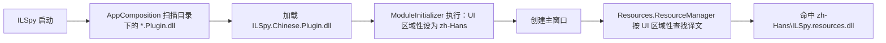

# ILSpy 简体中文汉化插件

在不修改 ILSpy 源码、主程序集和 XAML 的前提下，把 [ILSpy](https://github.com/icsharpcode/ILSpy) 的界面切换为简体中文。

实现方式是 ILSpy 官方的插件加载机制（`*.Plugin.dll`）+ 标准 .NET 卫星程序集（`zh-Hans\ILSpy.resources.dll`）。

- 目标版本：**ILSpy 11.2**（Avalonia 12 + .NET 10）
- 已翻译资源键：**416 个**（ILSpy `Properties/Resources.resx` 的全部键）
- 分发文件：**2 个**，删除即可还原英文，无需卸载程序

---

## 目录

- [特性](#特性)
- [工作原理](#工作原理)
- [目录结构](#目录结构)
- [环境要求](#环境要求)
- [构建](#构建)
- [安装](#安装)
- [卸载](#卸载)
- [验证](#验证)
- [已知限制](#已知限制)
- [维护翻译](#维护翻译)
- [许可证与致谢](#许可证与致谢)

---

## 特性

| 项目 | 说明 |
| --- | --- |
| 非侵入 | 不修改 ILSpy 的任何文件，只新增两个 DLL |
| 可还原 | 删除两个 DLL 即恢复英文界面 |
| 无耦合 | 插件不引用 `ILSpy.dll`，不依赖 ILSpy 内部 API |
| 自动回退 | ILSpy 升级后新增的资源键会自动回退英文，不会显示异常 |
| 标准机制 | 译文走 .NET 卫星程序集，由 ILSpy 自带的 `ResourceManager` 查找 |

---

## 工作原理



三个关键事实：

1. **插件发现**：ILSpy 在创建主窗口之前，会加载程序所在目录下所有文件名形如 `*.Plugin.dll` 的程序集（见 `ILSpy/AppEnv/AppComposition.cs`）。
2. **执行时机**：插件没有“启动钩子”导出点，因此使用 `[ModuleInitializer]`——程序集被载入时立即执行，早于主窗口创建，足以影响整个界面。
3. **资源查找**：ILSpy 的 `ResourceHelper.GetString` 调用 `Resources.ResourceManager.GetString(key)`，不显式传区域性，因此使用 `CurrentUICulture`；而 `ResourceManager` 会自动到主程序集目录下的 `zh-Hans\` 子目录查找 `ILSpy.resources.dll`。

因此插件只做一件事：把 UI 区域性设为 `zh-Hans`。译文本身完全交给 .NET 的资源机制。

> 只设置 UI 区域性（`CurrentUICulture`），不设置 `CurrentCulture`，避免影响反编译结果里数字、日期的格式化。

---

## 目录结构

```
.
├── ILSpy.Chinese.slnx                          # 解决方案（.NET 10 的 XML 解决方案格式）
├── src
│   ├── ILSpy.Chinese.Plugin                    # 插件：设置 UI 区域性
│   │   ├── ILSpy.Chinese.Plugin.csproj
│   │   └── PluginInitializer.cs
│   └── ILSpy.Chinese.Resources                 # 卫星程序集：中文资源
│       ├── ILSpy.Chinese.Resources.csproj
│       └── Resources.zh-Hans.resx              # 416 条中文译文
├── .editorconfig
├── .gitignore
└── LICENSE
```

两个项目都刻意保持极简：插件只有一个类、一个方法；资源项目只有一个 `.resx`。

---

## 环境要求

| 组件 | 版本 |
| --- | --- |
| .NET SDK | 10.0 或更高 |
| ILSpy | 11.2（其他版本见[已知限制](#已知限制)） |

---

## 构建

```powershell
# 在仓库根目录执行
dotnet build ILSpy.Chinese.slnx -c Release
```

产物：

| 产物 | 路径 | 是否需要分发 |
| --- | --- | --- |
| 插件 | `src\ILSpy.Chinese.Plugin\bin\Release\net10.0\ILSpy.Chinese.Plugin.dll` | 是 |
| 卫星程序集 | `src\ILSpy.Chinese.Resources\bin\Release\net10.0\zh-Hans\ILSpy.resources.dll` | 是 |
| 中间程序集 | `src\ILSpy.Chinese.Resources\bin\Release\net10.0\ILSpy.dll` | 否（卫星程序集构建的副产物） |

几条与构建相关的约定（修改 csproj 前请确认）：

- 插件文件名必须以 `.Plugin.dll` 结尾，这是 ILSpy 的发现规则，因此 `<AssemblyName>` 固定为 `ILSpy.Chinese.Plugin`。
- 卫星程序集必须与主程序集同名，因此资源项目的 `<AssemblyName>` 为 `ILSpy`、`<Culture>` 为 `zh-Hans`，产物才会落在 `zh-Hans\ILSpy.resources.dll`。
- 资源在 DLL 内的名字必须与 ILSpy 的 `ResourceManager` 基名一致：`ICSharpCode.ILSpy.Properties.Resources.zh-Hans.resources`。
- 两个项目的目标框架必须与 ILSpy 一致（`net10.0`）。

---

## 安装

假设 ILSpy 安装在 `<ILSpy>` 目录（例如 `C:\Program Files\ILSpy`）：

```powershell
# 1. 复制插件到 ILSpy 根目录
Copy-Item 'src\ILSpy.Chinese.Plugin\bin\Release\net10.0\ILSpy.Chinese.Plugin.dll' '<ILSpy>\'

# 2. 复制译文到 zh-Hans 子目录（目录不存在时先创建）
New-Item -ItemType Directory '<ILSpy>\zh-Hans' -Force | Out-Null
Copy-Item 'src\ILSpy.Chinese.Resources\bin\Release\net10.0\zh-Hans\ILSpy.resources.dll' '<ILSpy>\zh-Hans\'
```

安装后的目录形态：

```
<ILSpy>\
├── ILSpy.exe
├── ILSpy.dll
├── ILSpy.Chinese.Plugin.dll          ← 新增
└── zh-Hans\
    ├── ILSpy.resources.dll           ← 新增
    └── AvaloniaEdit.resources.dll    ← ILSpy 自带，勿删
```

---

## 卸载

删除以下两个文件即可，无需其他操作：

```powershell
Remove-Item '<ILSpy>\ILSpy.Chinese.Plugin.dll'
Remove-Item '<ILSpy>\zh-Hans\ILSpy.resources.dll'
```

> 不要删除整个 `zh-Hans` 目录：ILSpy 自带的 `AvaloniaEdit.resources.dll` 也在其中。

---

## 验证

启动 ILSpy 后，主菜单应显示“文件(F) / 视图(V) / 窗口(W) / 帮助(H)”。

也可以在不看图的情况下确认插件和译文都被加载：

```powershell
$p = Start-Process '<ILSpy>\ILSpy.exe' -PassThru
Start-Sleep -Seconds 5
$p.Modules | Where-Object { $_.ModuleName -in 'ILSpy.Chinese.Plugin.dll', 'ILSpy.resources.dll' } |
    Select-Object ModuleName, FileName
```

两项都出现在列表中，说明插件已执行、卫星程序集已被 `ResourceManager` 命中。

---

## 已知限制

| 限制 | 说明 |
| --- | --- |
| XAML 硬编码文本 | ILSpy 界面中有 73 个字符串直接写死在 XAML 里（如 `Search`、`Assemblies`、`Analyzer` 面板标题，导出项目 / 管理程序集列表 / 调试步骤对话框，工具栏提示等），它们不经过资源系统，卫星程序集无法覆盖，仍显示英文。 |
| 第三方库文本 | `Dock.Avalonia`、`AvaloniaEdit` 等依赖库自己的界面文本（如 `Line up`、`Tool tabs`、`Root dock`）同样不受本插件控制。 |
| 版本绑定 | 译文键名与 ILSpy 11.2 对齐。升级 ILSpy 后：新增键自动回退英文，已删除键不影响运行；如需完整覆盖需重新比对并补充翻译。 |
| 遗留语言配置 | 若 ILSpy 旧配置文件中存有 `<CurrentCulture>`（旧版 WPF 迁移遗留），ILSpy 启动时会按该值覆盖插件设置。清除该项即可恢复中文。 |
| 仅简体中文 | 不提供繁体中文或其他语种。 |

---

## 维护翻译

### 1. 获取上游资源文件

从 ILSpy 仓库获取对应版本的 `ILSpy/Properties/Resources.resx`（本仓库不内置上游源码）。

### 2. 比对键集合

```powershell
$up = [xml](Get-Content -Raw '<ILSpy源码>\ILSpy\Properties\Resources.resx')
$zh = [xml](Get-Content -Raw 'src\ILSpy.Chinese.Resources\Resources.zh-Hans.resx')

# 结果为空表示键集合完全一致；左侧 Only in reference 为缺失翻译的键
Compare-Object $up.root.data.name $zh.root.data.name |
    Select-Object SideIndicator, InputObject
```

### 3. 翻译约定

| 约定 | 示例 |
| --- | --- |
| 键名与上游完全一致 | `DecompilerSettings.UseStringInterpolation` |
| 保留占位符，包括格式说明 | `反编译在 {0:F1} 秒内完成。` |
| 菜单加速键用下划线前缀 | `_File` → `文件(_F)` |
| 文件过滤器保留 `|` 分隔符 | `\|All Files\|*.*` → `\|所有文件\|*.*` |
| XML 特殊字符需转义 | `Span<T>` → `Span&lt;T&gt;` |
| 多行文本保留换行 | 提示框中的“是否要继续？”等 |

### 4. 重新构建并安装

见[构建](#构建)与[安装](#安装)。

---

## 许可证与致谢

- 本项目代码与译文采用 [MIT License](LICENSE)。
- 译文原文来自 [ILSpy](https://github.com/icsharpcode/ILSpy)，同样采用 MIT License，版权归 `AlphaSierraPapa for the SharpDevelop Team` 所有。
- 本插件依赖 ILSpy 的插件加载与资源查找机制，未修改其任何代码。
